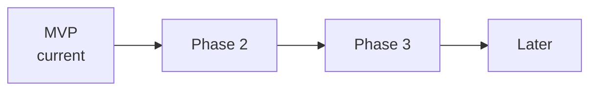

# AGENTS.md

Rules for AI agents working on **Fingeist**. Read the other docs when the task needs them:

- [DESIGN.md](DESIGN.md): architecture, data format, sync and merge, domain rules, design system. Read the relevant section before changing `core`, sync or the UI.
- [USAGE.md](USAGE.md): what the app does, from a user's side.
- [README.md](README.md): install, self-hosting, commands, layout.

## Git

- **Allowed:** `git status`, `git diff`, `git log`, `git show`, `git blame`, `git branch` (list only).
- **Everything else needs the owner's explicit permission, for that action, in this conversation**: commit, push, merge, rebase, reset, restore, stash, tag, add, and creating, switching or deleting branches. Earlier permission doesn't carry over.
- Editing files is fine on whatever branch is checked out, `main` included.
- When done: summarize what changed and why, suggest a commit message, and stop.

## Phases

Build only the current phase. If a task needs something from a later phase, ask.

| Phase | Contents |
|-------|----------|
| **MVP** (current) | Everything in the checklist below |
| **2** | Gitea/Forgejo adapter (covers Codeberg and self-hosted), GitLab adapter, snapshots, multiple projects, customizable dashboards (choose, order and hide charts and cards) |
| **3** | Stock market and investment tracking: holdings, buys and sells, prices, portfolio value. Live prices would need a source other than the sync host, which *Never* rules out today, so revisit that rule with the owner first |
| **Later** | More chart types, receipts |
| **Never** | A server or backend of our own, our own user accounts, telemetry, analytics, network calls to anything but the user's sync host |

### MVP checklist

All of these are built; keep them working.

- **App:** a PWA on GitHub Pages, fully usable offline. One project; currency chosen at creation (INR by default) and fixed.
- **Entries:** Expense, Income, Refund and Transfer; amounts as sums (`120+45`); items across categories and shares with people; intent (Need, Want, Impulse) for expenses; merchant suggestions; editable time, with "time unknown"; repeating entries; add again, delete with undo.
- **Ledger:** grouped by day with totals; search; type pills; month, category, account and date-range filters; bulk recategorise.
- **Accounts and people:** opening balance, rename, merge, archive, delete when unused, balances, settle up.
- **Categories:** start empty (Uncategorized is built in); colours, rename, merge (undoable), archive, delete; monthly budgets.
- **Dashboard:** date presets and custom range, account filter, summary cards with comparison, budgets, and the charts in [USAGE.md](USAGE.md#dashboard), with drill-down into the ledger.
- **Settings:** project name, month start day, small-purchase thresholds (default ₹100/250/500/1000), repeats, export to JSON and CSV, erase device.
- **Sync:** encrypted through a private GitHub repository, with notes for real conflicts, restorable deletes, fixable unreadable entries and wrong-clock warnings.

## How to work

- **Do what was asked, nothing more.** No unrequested features, refactors, renames or cleanups; mention them instead.
- **Smallest change that works.** No speculative interfaces, options or abstractions for future phases.
- **Don't add files** unless the task needs them.
- **No new dependencies** without asking. Approved: `echarts`, `vite`; for development only `typescript` (type checking), `happy-dom` (UI smoke test), Biome from nixpkgs, and Node's built-in modules.
- **Ask** when a requirement is ambiguous.
- **Sync format changes need the owner's approval first:** kinds, record fields, file layout, `vault.json`, encryption. Propose, get a yes, then document it in DESIGN.md.
- **Keep docs true,** in the same task:
  - user-visible behaviour → USAGE.md
  - architecture, data format, sync, design system → DESIGN.md
  - commands, setup, layout → README.md
  - rules and phases → this file
- **Phases and MVP scope live only in this file.** The other docs describe what exists, not plans.
- Don't edit generated files: `dist/`, `node_modules/`.

## Environment

- Work inside `nix develop`. Add tools to `flake.nix`; never install globally. Don't run `nix flake update` unless asked.
- Use the helpers in `flake.nix`: `dev`, `check`, `fmt`, `build`, `preview`. New helpers go there too.
- The dev server is a separate browser origin from the deployed app. Never point a dev build at the owner's real data repository; use a throwaway one. `actual-data/` is private and ignored: never read it into docs or commits.

**Done means** `check` passes and `build` succeeds; run `fmt` to fix formatting.

For UI changes:
- When the Safari MCP server is available, check the change in `dev` at desktop and phone widths: screenshots, plus an overflow check.
- Otherwise say what to check, and don't claim it was verified.

## Rules

### Architecture

- `src/ui` → `src/core` → nothing. `src/platform` wraps browser APIs and is handed to `core` by `src/main.js`.
- **`core`** is pure: no DOM, `window`, storage, global `fetch` or `Date.now()`; everything comes in as parameters.
- **`core/report`:** transactions in, plain objects out; percentages and comparisons are formatted here.
- **`ui`:** renders only; no aggregation or money math.

### Data

- **Money** is a `BigInt` of minor units from `core/money.js`. Never `Number`, `parseFloat`, `parseInt`, `toFixed` or `Math.*` on amounts.
  - Records and exports use `formatMoney` (`-12.50`).
  - The UI gets `{text, whole, fraction, size, negative}` from `report/amount.js`; `size` is the only `Number`, for drawing.
  - Display text uses `MINUS` (U+2212) and is never stored or parsed.
- **Time** is RFC 3339 with offset, or a bare date for "time unknown". Never invent a time. Never bucket with `Date`; use `core/time.js`.
- **Local first:** apply and queue every change before any network call.
- **Append-only log:** a device writes only under `devices/<its id>/` and treats "already exists" on its own path as success.
- **Merge:** per field, highest clock wins.
  - Fields that must agree are written together; add new ones to `TOGETHER` in `core/workspace.js`.
  - Every local change carries `base`.
  - Never refuse or rewrite another device's stamps.
- **Malformed changes** are kept in the log, left out of state and listed in the UI; never dropped.
- **Network:** only the hosts in `src/sync-hosts.json` and the CSP. Tests pass a fake `fetch`.

### Code

- Plain JavaScript ES modules with JSDoc types checked by `tsc`; shared shapes in `src/core/types.js`. Biome decides formatting.
- Small functions and focused files. Throw `Error` with a clear message; `core` never swallows errors.
- **Readable code over comments.** Comment only a non-obvious *why*, in one short sentence. JSDoc on exported functions, one line, only where the name isn't enough.
- **Markdown:** no emoji; diagrams are Mermaid. Keep docs short: headings, short paragraphs, lists and tables.

### UI

Follow the design system in [DESIGN.md](DESIGN.md#design-system). In code:

- Use only the tokens at the top of `src/ui/style.css`: spacing, heights, font sizes, radii, colours, motion. No one-off values.
- Add children with `el()` or `fill()`, which skip `null`. `append`/`replaceChildren` print `null` as text.
- `field()` labels one input; for a group of buttons it makes a named group.
- Hints go behind `infoTip()` or a `field()` hint, not standing text.
- Dates in text use `dateText()`. Large amounts use `figure()`.
- Each colour keeps its one meaning. The new-category palette in `core/catalog.js` avoids the meaning colours.
- Motion:
  - Entrances use `.enter`; sideways slides use `slideOut`/`slideIn` with `.paged`.
  - `motion()` in `charts.js` mirrors the CSS timing.
  - Everything respects reduced motion.
- One renderer per chart type in `src/ui/charts.js`, and one option-builder per ECharts chart.

### Adding a chart type

1. Pure aggregation in `src/core/report`, with tests.
2. A case in the `run(def, data, project, scope)` dispatcher.
3. One renderer in `src/ui/charts.js`.
4. Add it to `CHARTS` in `src/core/report/index.js`, and to the chart table in USAGE.md.

## Testing

- Table-driven `node:test` tests next to each module (`*.test.js`); fixtures in `testdata/`.
- **`core` needs thorough tests,** including the edge cases:
  - amounts: parsing, rounding, grouping
  - time: offsets, DST, month starts, date-only rows
  - merge: order, ties, tombstones, field groups, `base` and conflict notes, clock skew
  - repeats, splits, refunds, transfers and people
  - every report
  - sync: outbox, retries, auth and offline failures, encryption and tampering
- **Sync behaviour** is tested with two devices on `memoryRemote()` (see `src/core/app.test.js`).
- **`src/architecture.test.js`** checks the architecture and money rules against the source; extend it with new rules.
- **`src/ui/ui.test.js`** (happy-dom) renders every screen and dialog empty and with a full book, and fails on errors or `null`/`undefined`/`NaN` on the page. Extend it with new screens.
