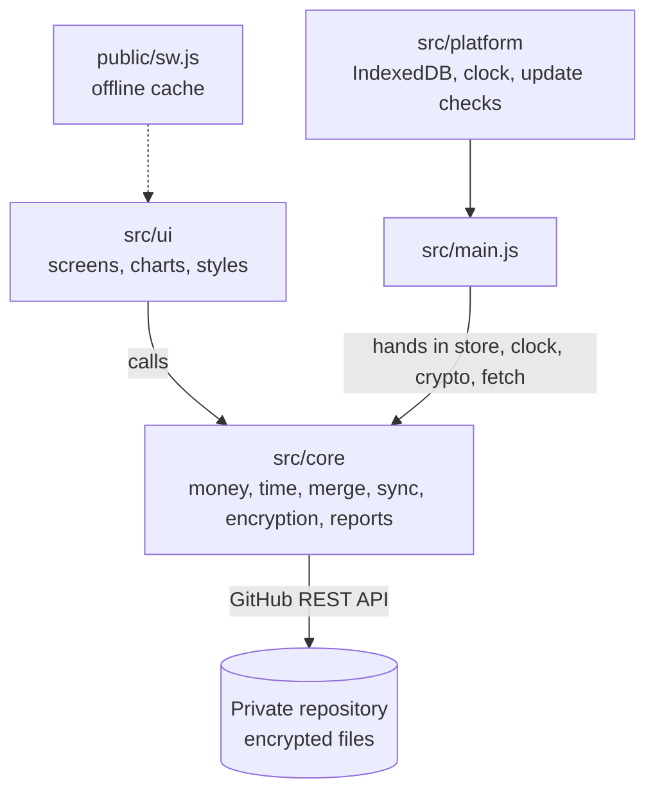
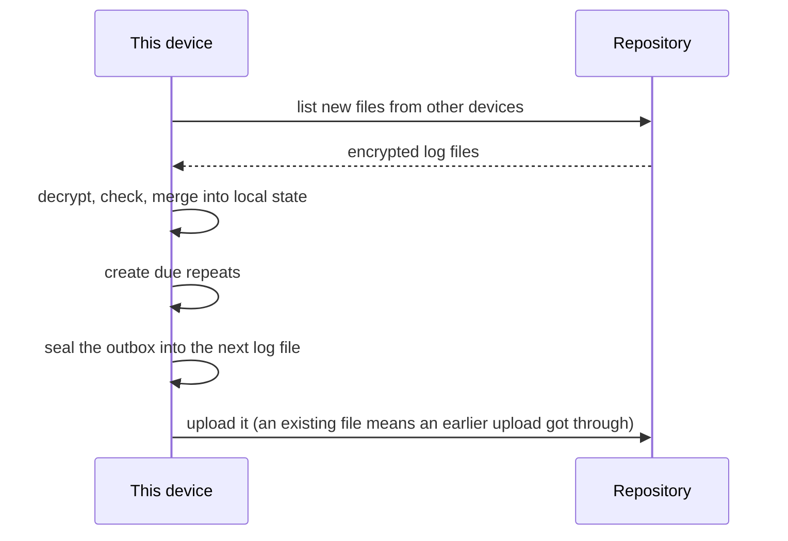
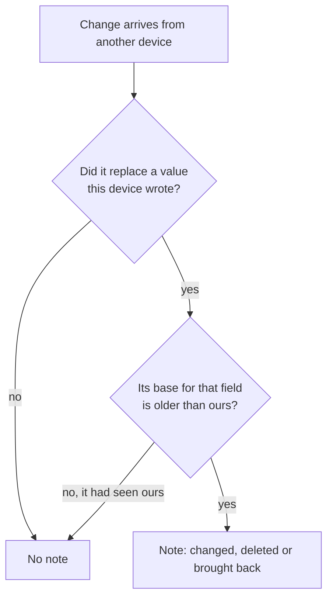

# Design

How Fingeist works and how it looks. For using the app, see [USAGE.md](USAGE.md).

## Architecture



- **`core` is pure.** It gets storage, time, crypto and `fetch` as parameters, so all of it runs and is tested under Node.
- **`core/report`** turns transactions into plain, formatted data for each chart. It knows nothing about ECharts.
- **`ui` only renders** what `core` hands it: formatted text, and sizes for bars and cells.
- **Plain JavaScript** modules with JSDoc types, bundled by Vite. ECharts draws the line and bar charts.
- **Offline:** `public/sw.js` caches the app and revalidates the page on each open; `src/platform/updates.js` checks for a newer deploy when the app returns to the foreground and offers a reload.

## Data

### Storage

Each device keeps its own copy in IndexedDB: the merged state, an outbox of changes not yet sent, and what it has pulled. Every change is applied locally and queued before any network call, so being offline never blocks anything.

### Repository layout

```
vault.json                       passphrase-wrapped data key and encrypted project meta
devices/<deviceId>/00000001.bin  encrypted change log, one file per sync
```

- **A device writes only under its own folder** and never changes a file, so devices never overwrite each other. `vault.json` is rewritten only when the passphrase changes.
- **Log files** are a version byte, a 12-byte nonce and AES-256-GCM ciphertext of JSON Lines, with the file's path as additional data, so a file can't be swapped for another.
- **The data key** is wrapped with PBKDF2-SHA256 (600,000 iterations) from the passphrase. It never leaves WebCrypto unwrapped, and the passphrase is never stored.
- **Meta** holds the project name, currency and decimal places, fixed at creation.

### Change records

Each line of a log file is one change:

```json
{"kind":"txn","id":"01KA…","op":"put","clock":"1763112600000-0000","device":"01KA…","fields":{"note":"dinner"},"base":{"note":"1763112000000-0000"}}
```

- `op` is `put` (set these fields) or `delete` (a tombstone).
- `clock` is a hybrid logical clock, `<ms>-<counter>`; plain string comparison orders it.
- `base` (optional) is the clock of each field version the change replaced. See [Conflicts](#conflicts).

| `kind` | `id` | Fields |
|--------|------|--------|
| `txn` | ULID | `time`, `amount` (negative: expense), `account`, `category`, `merchant`, `note`, `tags`, `intent`, `refund`, `splits`, `recurring` |
| `transfer` | ULID | `time`, `amount` (positive), `from`, `to`, `note`, `recurring` |
| `category` | ULID | `name`, `color`, `archived`, `mergedInto` |
| `account` | ULID | `name`, `kind` (`own` or `person`), `opening`, `archived`, `mergedInto` |
| `budget` | category id | `amount` (monthly) |
| `recurring` | ULID | `entry` (`txn` or `transfer`), `template`, `every`, `start`, `until`, `paused` |
| `setting` | `project` | `name`, `thresholds`, `monthStart` |
| `device` | device id | `name` |

- **Amounts** are decimal strings such as `"-12.50"`, never numbers.
- **Times** are RFC 3339 with offset, or a bare date when the time is unknown.
- **References** are ids, never names. `mergedInto` redirects a category or account; a deleted category leaves its entries Uncategorized.
- **Items** (`splits`) are the lines of a bill: `[{category, person, amount, intent, note}]`, adding up to the amount. One unnamed item for yourself is stored as a plain entry without `splits`. A part's `intent` is optional (it falls back to the entry's); your own parts may be negative, for a discount; a share with a person is always positive; refunds can't be shared.
- **Repeats** create each due entry with the id `<repeat id>.<date>`, so two devices creating it offline write the same record, and a deleted one stays deleted.

## Sync

A sync pulls what other devices wrote, merges it, and uploads this device's queue:



### Merge

- **Per field, last writer wins:** for each `(kind, id, field)` the highest clock wins, device id breaking ties. Applying a change twice changes nothing, and order doesn't matter.
- **Edits write only what changed,** so edits to different fields on two devices both survive.
- **Related fields go together.** A transaction's `amount`, `splits` and `refund`, and a transfer's `from` and `to`, are written as a group whenever one changes. They share a stamp, so a merge can't mix one device's amount with another's items.
- **Deletes are tombstones.** A record is live while some field is newer than its tombstone, so a later edit brings it back.
- **Malformed data is never dropped:** it stays in the log, is left out of the state, and is listed in the app.

### Conflicts

A note appears only when another device changed something without having seen this device's edit:



- Changes from older apps have no `base`; for them, the test is whether ours had been uploaded before they were made.
- Saving or deleting an entry clears its notes.

### Clocks

- A device's clock adopts the highest clock it has seen, so a later edit always outranks what it has seen.
- A counter of 0 means the device read its own time; above 0 means it carried on from a later clock.
- A device that stamps its own time more than a day ahead is reported by name. Its stamps are never refused or rewritten, since that would let it beat later edits.

## Domain rules

- **Money** is a `BigInt` of minor units, made only by `core/money.js`. It is never a float. The UI gets text, plus a `size` used only for drawing.
- **Transfers** only move balances; they are never income, spending or intent.
- **Refunds** lower spending in their category and are never income.
- **A share with a person** is what they owe you, not your spending. Only your own accounts count in your balance.
- **Dates and hours** come from the stored string, never from `Date`. An entry without a time counts in every date view but not in hour charts.
- **Display:** amounts show the currency symbol, standard thousands grouping (no lakh grouping) and a true minus sign (−). Dates in text read like "Nov 1, 2026". Stored and exported values stay plain (`-12.50`).

## Design system

The look is defined by tokens at the top of `src/ui/style.css`. Light and dark follow the system setting, charts included.

### Principles

- **One app for every screen size,** adapted by CSS, never two versions of a screen. It works from 360px wide up.
- **Calm by default:** colour carries meaning, hints hide behind (i) buttons, and stats sit flat inside cards.
- **Quiet motion** that shows where things come from and never slows anything down.

### Tokens

| Token | Values | Use |
|-------|--------|-----|
| `--s-1` … `--s-8` | 4, 8, 12, 16, 20, 24, 32px | All spacing |
| `--h-sm`, `--h-md` | 26, 32px (36, 40px on touch) | Control heights |
| `--fs-xs` … `--fs-2xl` | 11, 12, 14, 16, 22, 28px | All font sizes; body is 15px on touch screens |
| `--r-mark`, `--r-inner`, `--r-card`, `--r-float` | 6, 12, 20, 26px | Corners, rounder as things get bigger |

### Colour

Each colour has one meaning:

| Colour | Means |
|--------|-------|
| Green | Income, or better |
| Orange | Expense, worse, or impulse |
| Amber (`--warn`) | Close to a limit |
| Red (`--danger`) | Over a limit, or destructive |
| Accent blue | Interaction and neutral data |

- Need is a calm slate and want a violet, apart from the accent.
- The palette for new categories leaves out all of those hues, so a category's colour never reads as good or bad.

### Shapes and type

- **Capsules** for buttons, pills, chips and selects; rounded rectangles for text fields and for dates inside forms.
- **A selected control** has one look: a tinted fill with accent text.
- **Labels** are sentence case, small and muted. Only dashboard section headings are uppercase.
- **Stats in a card** are a label over a value with a thin rule, never boxes inside the card, and never one left alone on a row.
- **Large figures** show their minor units smaller and muted.
- **Icons** are Fingeist's own line icons, always beside a label or with an accessible name. No emoji.

### Surfaces

- **Cards** are solid with a hairline edge and a faint shadow, over a soft fixed colour field.
- **Glass** (translucent, blurred) is only for layers that float over the page: the top bar, the phone tab bar, the date capsules of sticky ledger headers, dialogs and notices. It turns solid when the system asks for reduced transparency.
- Safari doesn't blur glass inside glass, so the date popover and dialog footers are solid.

### Layout

- **Navigation** sits in the top bar on wide screens and in a tab bar docked to the bottom below 700px. **+ Entry** always stays in the top bar. Nothing floats over the content.
- **Dialogs** are centred on wide screens and bottom sheets on phones, with their buttons always in view.
- **A list row** is one button that opens it; actions live in its dialog.
- **Wide rows** of pills or filters scroll sideways on phones rather than wrapping.
- **Touch screens** get targets of at least 36–40px and 16px input text.
- Under a notch or Dynamic Island, the top bar keeps its content clear of the status bar blur.

### Motion

- **Tokens:** `--t-fast`/`--t-base` for state changes, `--t-enter`/`--ease-enter`/`--stagger` for entrances, `--spring` only for the desktop dialog, the sliding pill highlight and press release.
- **Opening a screen:** cards rise in order, then their bars, calendar days and charts grow in once the card lands.
- **Switching tabs** slides pages sideways in the tab's direction; so does picking a dashboard range to the left or right.
- **Only** opacity, transform and colour animate, and everything stops when the system asks for reduced motion.
