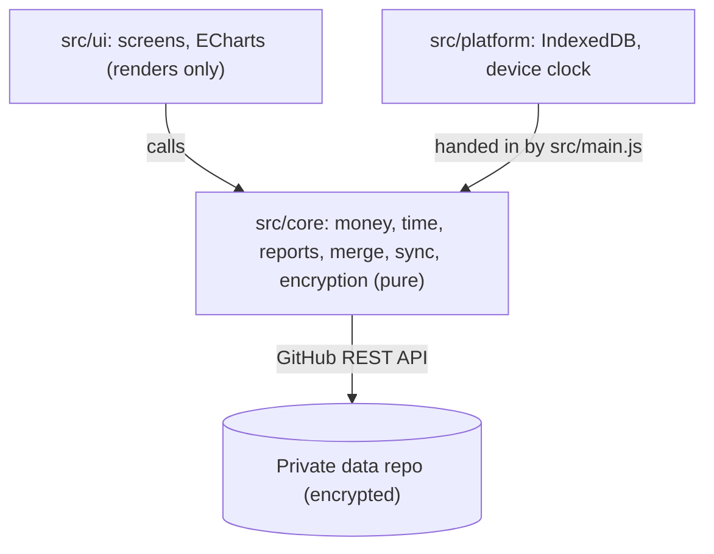

# Fingeist

A personal expense ledger that runs in the browser, works offline, and syncs between your devices through a private GitHub repository you own. Everything is encrypted on the device before it is uploaded. There is no Fingeist server, account or telemetry.

> **Status:** MVP. See the Scope table in [`AGENTS.md`](AGENTS.md).

## Using it

**Install** from the deployed site (e.g. `https://<you>.github.io/fingeist/`):

| Device | How |
|--------|-----|
| iPhone, iPad | Safari, Share, *Add to Home Screen* |
| Mac | Safari, File, *Add to Dock* |
| Windows, Linux | Chrome or Edge, *Install* in the address bar |

**Set up sync** on your first device:

1. Create an empty private GitHub repository, e.g. `fingeist-data`.
2. Create a fine-grained token limited to that repository with *Contents: Read and write*. Make one per device, so you can revoke one alone.
3. In Fingeist: Settings, Sync, *Set up sync*, with the repository, token and a passphrase.

On other devices, choose *Join from another device* on the first screen, with a new token and the same passphrase. Keep the passphrase in a password manager: without it, no new device can read the data.

## Architecture



Plain JavaScript modules, bundled by Vite, with ECharts. `core` takes the store, crypto, `fetch` and clock as parameters, so it is fully tested under Node. Every change is saved locally first and queued; sync pulls other devices' files, merges them, and uploads this device's queue. `public/sw.js` keeps the app usable offline.

## Data format

```
vault.json                      passphrase-wrapped data key, encrypted project meta
devices/<deviceId>/00000001.bin encrypted change log, one file per sync
```

- **Log files** are a version byte, a 12-byte nonce, and AES-256-GCM ciphertext of JSON Lines, with the file's path as additional data. A device writes only under its own folder and never changes a file. `vault.json` is overwritten only when the passphrase changes.
- **The data key** is wrapped with PBKDF2-SHA256 (600,000 iterations) from the passphrase. **Meta** holds the name, currency and decimal places, fixed at creation.
- **Merge is per field:** a change carries only the fields it sets, and for each `(kind, id, field)` the value with the highest hybrid logical clock (`<ms>-<counter>`) wins, device id breaking ties. A delete is a tombstone; a later edit brings the record back. Edits to different fields on two devices both survive.

```json
{"kind":"txn","id":"01KA…","op":"put","clock":"1763112600000-0000","device":"01KA…","fields":{"note":"dinner"}}
```

| `kind` | `id` | Fields |
|--------|------|--------|
| `txn` | ULID | `time`, `amount` (negative: expense), `account`, `category` (ids; `""` is Uncategorized), `merchant`, `note`, `tags`, `intent` (expenses), `refund` (positive amounts), `splits` (`[{category, person, amount, intent, note}]`, the lines of an itemised bill, adding up to the amount; see below), `recurring` |
| `transfer` | ULID | `time`, `amount` (positive), `from`, `to`, `note`, `recurring` |
| `category` | ULID | `name`, `color`, `archived`, `mergedInto` |
| `account` | ULID | `name`, `kind` (`own` or `person`), `opening`, `archived`, `mergedInto` |
| `budget` | category id | `amount` (monthly) |
| `recurring` | ULID | `entry` (`txn` or `transfer`), `template`, `every` (`day`, `week`, `month`, `year`), `start`, `until`, `paused` |
| `setting` | `project` | `name`, `thresholds`, `workdays`, `monthStart` |
| `device` | device id | `name` |

- Amounts are decimal strings, never numbers. Times are RFC 3339 with offset, or a bare date when the time is unknown.
- Names can change because everything refers to ids. A `mergedInto` redirects a category or account to another one; a deleted category leaves its entries Uncategorized.
- A person is an account: a share split with them, or money moved to them, is what they owe you. Only `own` accounts count in your balance.
- A split part's `intent` is optional and only kept on expenses; a part without one uses the transaction's `intent`. Your own parts may be negative, for a discount, which lowers spending in that part's category; a share with a person is always positive. A part's optional `note` is the item name. The form sets the amount to the total of the parts. Every entry is entered as items: one unnamed item for yourself is stored as a plain entry with no `splits`; anything else (a named item, several items, a share) is stored as `splits`, which may have a single part. A refund may have items but no share with a person. Older apps read the extra `intent` and `note` as absent, and list a split with a negative part, a single part, or a refund with items as unreadable until they update.
- Repeats create each due entry with the id `<repeat id>.<date>`, so two devices creating it offline write the same record, and a deleted one stays deleted.

## Self-hosting

Fork the repository, then set Settings, Pages, Source to *GitHub Actions*; each push to `main` tests, builds and deploys. Whoever serves the app could read the token and passphrase on devices using it, so deploying your own fork is the safest choice. `src/sync-hosts.json` lists the only hosts the app may connect to.

## Development

With [Nix](https://nixos.org) (flakes enabled), on macOS or Linux:

```sh
nix develop   # then:
dev           # live-reloading dev server on http://127.0.0.1:5173
check         # lint, format check, type check, all tests
fmt           # format and apply safe lint fixes
build         # production build into dist/
preview       # build and serve dist/, to try offline mode
```

`check` runs Biome, `tsc` over JSDoc types, the `core` tests, an architecture test, and a UI smoke test in happy-dom. CI runs `check` and `build` before every deploy. The dev server is a different browser origin from the deployed app, so its data is separate; to try sync, use a throwaway repository.
