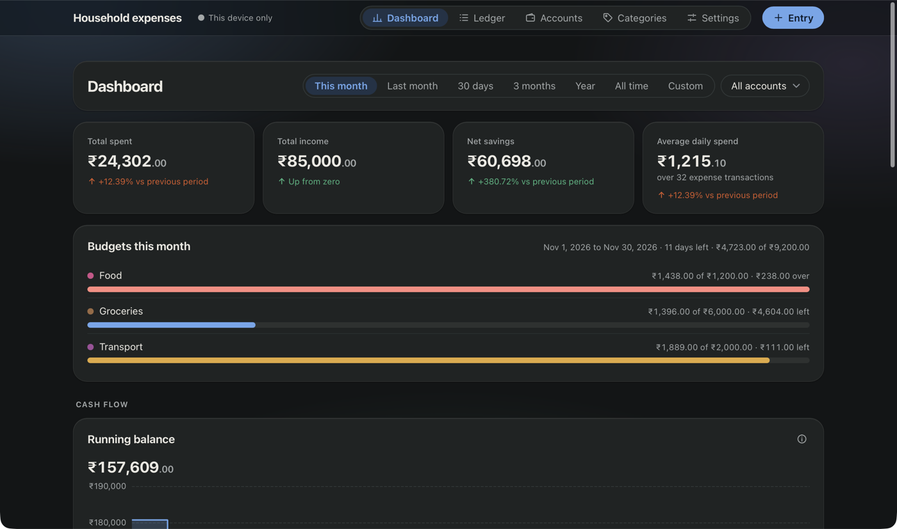

# Fingeist

A personal expense ledger that runs in your browser, works offline, and syncs between your devices through a private GitHub repository you own.



- **Yours alone.** Everything is encrypted on your device before it leaves it. There is no Fingeist server, account or telemetry.
- **Works offline.** Every change is saved on the device first and syncs when there is a connection.
- **One app everywhere.** Install it on a phone, tablet or computer; the same screens adapt to each.

## Documentation

| File | For |
|------|-----|
| [USAGE.md](USAGE.md) | Using the app: entries, ledger, budgets, dashboard, sync |
| [DESIGN.md](DESIGN.md) | How it works: architecture, data format, sync, and the visual design system |
| [AGENTS.md](AGENTS.md) | Rules for AI agents and contributors working on the code |

## Install

Open the deployed site (for example `https://<you>.github.io/fingeist/`) and install it:

| Device | How |
|--------|-----|
| iPhone, iPad | Safari, Share, *Add to Home Screen* |
| Mac | Safari, File, *Add to Dock* |
| Windows, Linux | Chrome or Edge, *Install* in the address bar |

Then follow [USAGE.md](USAGE.md) to create a project and, if you like, set up sync.

## Self-hosting

1. Fork this repository.
2. In the fork's Settings, Pages, set Source to *GitHub Actions*.
3. Push to `main`: CI tests, builds and deploys it.

Whoever serves the app could read the token and passphrase on devices that use it, so deploying your own fork is the safest choice. `src/sync-hosts.json` lists the only hosts the app may connect to.

## Development

With [Nix](https://nixos.org) (flakes enabled), on macOS or Linux:

```sh
nix develop   # then:
dev           # live-reloading dev server on http://127.0.0.1:5173
check         # lint, format check, type check, all tests
fmt           # format and apply safe lint fixes
build         # production build into dist/
preview       # build and serve dist/, to try offline mode
```

- `check` runs Biome, `tsc` over JSDoc types, the unit tests, an architecture test and a UI smoke test in happy-dom. CI runs `check` and `build` before every deploy.
- The dev server is a different browser origin from the deployed app, so its data is separate. To try sync, use a throwaway repository.

| Path | Holds |
|------|-------|
| `src/core` | Money, time, merging, sync, encryption and reports; pure and tested under Node |
| `src/ui` | Screens, charts and styles |
| `src/platform` | Browser wrappers: storage, clock, update checks |
| `public` | Service worker, manifest, icons |
