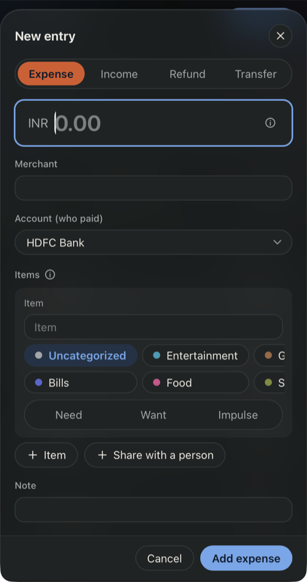
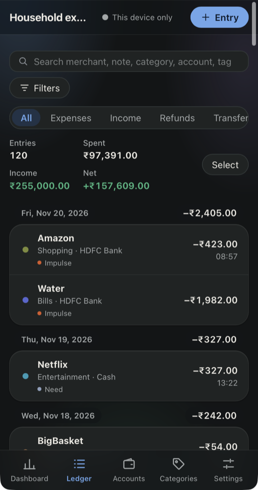
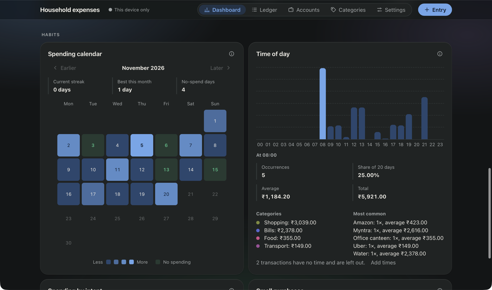

# Using Fingeist

A guide to everyday use. For installing the app, see the [README](README.md).

Hints sit behind the round **(i)** buttons next to titles and fields; tap one to read it.

## First start

The first screen offers two paths:

- **Start a new project** on your first device. Pick a name, a currency code (INR by default) and its decimal places. The currency can't be changed later.
- **Join from another device** if you already sync elsewhere. See [Sync](#sync).

Your data lives in this browser until you set up sync.

## Adding entries

Tap **+ Entry** in the top bar.

1. **Pick the type:** Expense, Income, Refund or Transfer.
2. **Type the amount.** Sums work too: `120+45` saves 165.
3. **Pick the account** that paid, or a person who paid for you. *New account…* adds one on the spot.
4. **Fill in the item:** a category, and for expenses an intent (Need, Want or Impulse).

More options:

- **Merchant** remembers the category and account you used last time and fills them in.
- **+ Item** splits a bill into lines with their own category and intent. A negative line is a discount. The amount becomes the total of the lines.
- **Share with a person** records a part that someone else owes you.
- **When** is now by default. Clear the time if you don't know it; the entry keeps only its date.
- **Repeat** (new entries only) creates the entry every day, week, month or year, optionally until a date.

To change an entry, tap it in the ledger. Its sheet also has **Add again** (a copy for today) and **Delete**, which you can undo.

## Ledger

- Entries are grouped by day, newest first, with each day's total.
- **Search** looks through merchant, note, category, account, people and tags.
- The pills narrow it to Expenses, Income, Refunds, Transfers, Needs, Wants or Impulses.
- **Filters** add a month, category or account. Active filters show as chips; tap one to remove it.
- The totals above the list follow whatever is shown.
- **Select** lets you pick many entries and move them to one category. Entries with several items are skipped.

## Accounts and people

- **Your accounts** are bank accounts, cash and cards. A debt, such as a credit card, has a negative balance.
- **People** are friends you split with or who pay for you. A positive balance means they owe you.
- Open one to rename it, change its opening balance, archive it, merge it into another, or see its **Entries**.
- **Settle up** on a person starts a transfer for what is owed.
- An account can only be deleted when no entry uses it.

## Categories and budgets

- Projects start with no categories; **Uncategorized** is built in.
- Open a category to rename or recolour it, set a **monthly budget**, archive it, merge it into another, or delete it.
- Archived categories leave the picker but stay on existing entries.
- A merge can be undone. Deleting a category leaves its entries Uncategorized.

## Dashboard

- **Range:** This month, Last month, 30 days, 3 months, Year, All time, or Custom dates.
- **Account:** all accounts, or one.
- **Summary cards:** total spent, total income, net savings and average daily spend, each compared with the period of the same length before.
- **Budgets this month:** blue while on track, amber from 85% used, red when over.

The charts are grouped by the question they answer:

| Group | Chart | Shows |
|-------|-------|-------|
| Cash flow | Running balance | Your balance day by day, with today's above it |
| Cash flow | Monthly totals | Income and expenses per month (ranges of two months or more) |
| Where it goes | Spending by category | Each category's spending and its change; tap a row to see its entries |
| Where it goes | Top merchants | Where the money went most |
| Habits | Spending calendar | Days shaded by spending, no-spend days and streaks; tap a day to see it |
| Habits | Time of day | Spending by hour; pick an hour for its details |
| Habits | Spending by intent | The split between needs, wants and impulses |
| Habits | Small purchases | Expenses at or under a threshold and their share |

Entries without a time are left out of Time of day; **Add times** lists them.

## Settings

- **Project:** name, the fixed currency, and the day months start on (for a salary cycle, such as the 25th).
- **Small purchases:** the thresholds the dashboard offers.
- **Repeats:** pause, resume or stop each repeating entry. Entries already added stay.
- **Export:** everything as JSON, or the ledger as CSV.
- **This device:** erase what Fingeist stores here. Synced data stays in the repository.

## Sync

Sync keeps your devices in step through a private GitHub repository. Files are encrypted before they leave the device.

### Set up the first device

1. Create an **empty private** GitHub repository, for example `fingeist-data`.
2. Create a fine-grained token limited to that repository with *Contents: Read and write*. Make one per device, so you can revoke one alone.
3. In Settings, Sync, choose **Set up sync** and enter the repository, the token and a passphrase.

Keep the passphrase in a password manager. Without it, no new device can read the data.

### Join from another device

On the first screen of a new device, choose **Join from another device** with the same repository and passphrase and a new token.

### What the status means

The dot next to the project name shows the sync state:

| Status | Meaning |
|--------|---------|
| This device only | Sync is not set up |
| Synced | Up to date; *N not synced* counts changes waiting to go |
| Offline | Changes are kept and sync when you are back online |
| Sync paused | The token was rejected; replace it in Settings |
| Sync failed | It will try again; tap the status to open Settings, Sync |

### When devices disagree

Edits to different fields on two devices both survive. When two devices change the same thing before syncing, the later change is kept and the other device shows a note:

- **Changed:** what the other device changed, from your value to its value. *Open* the entry or *Dismiss* the note.
- **Deleted:** another device deleted an entry you were editing. *Restore my version* brings it back.
- **Back:** another device edited an entry you had deleted, so it returned.

Two other notices may appear:

- **Some entries can't be shown:** usually left by an older version of the app. *Open to fix* lets you correct and save it, or *Delete* it.
- **A device has the wrong time:** one device's clock is days ahead, so its edits win until it is fixed. Check its date and time settings.

## Offline and updates

- The app works without a connection once it has loaded.
- When a new version is ready, a notice offers **Reload**.
